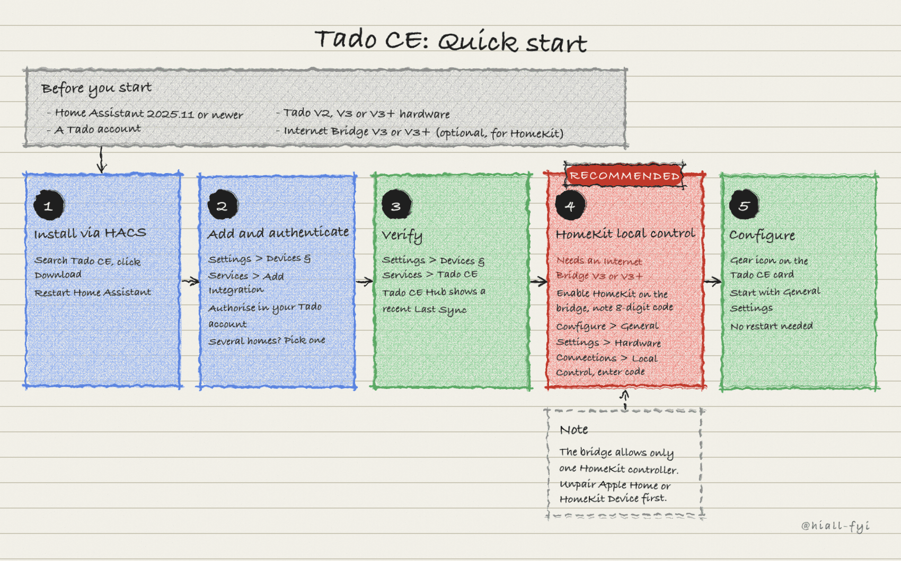

# Tado CE - Community-maintained Tado integration for Home Assistant

<div align="center">

   

 [](https://buymeacoffee.com/hiallfyi)

**Tado CE reads your Tado heating locally over HomeKit, saves your daily API calls, and adds what the built-in Home Assistant integration doesn't have: multi-home, Smart Valve Control and Weather Compensation.**

[Quick Start](#quick-start) • [Features](#features) • [Configuration](#configuration) • [FAQ](#faq) • [Discussions](https://github.com/hiall-fyi/tado_ce/discussions)

</div>

---

## About

Tado CE is an alternative Home Assistant integration for Tado, built around requests the built-in Home Assistant Tado integration (HA Core) hasn't picked up. It is developed independently of Tado and works with Tado V2, V3 and V3+ hardware.

---

## Why use Tado CE

Three situations where it's worth considering:

1. **You've hit the Tado API quota.** Since 2025 Tado limits most households to 100 API calls a day, and the built-in integration only polls the cloud, so dashboards lag by 15 to 20 minutes. With an Internet Bridge V3 or V3+ paired over HomeKit, Tado CE reads room temperature and target temperature locally in about 2 seconds, without touching your quota. On a nine-zone test home, daily API usage dropped from about 394 calls to under 80.
   [Learn more: Smart Polling & API Management →](FEATURES_GUIDE.md#smart-polling)
2. **Your TRV reads hot and the room never reaches target.** A TRV (thermostatic radiator valve) sits on the radiator and reads warmer than the room, so Tado closes the valve before the room is warm. Smart Valve Control fixes that with an external sensor, either by changing the temperature offset Tado's own algorithm sees (Offset Sync) or by overriding the setpoint (Valve Target).
   [Learn more: Smart Valve Control →](FEATURES_GUIDE.md#smart-valve-control)
3. **You need a feature the built-in integration doesn't have.** Multi-home support, Weather Compensation for OpenTherm boilers, Actionable Insights, mould-risk monitoring, thermal analytics and a schedule calendar. See the comparison below.
   [Learn more: Advanced Analytics, Automation & Integration →](FEATURES_GUIDE.md#thermal-analytics)

If none of those apply, the built-in Tado integration is fine. Tado CE isn't meant to replace a healthy install; it's the option for when a specific need arises.

---

## Feature comparison


Two of the checkmarks above are newer than they look. HA Core has since added its own quota-aware polling and a heating-circuit select, so the difference now is depth, not presence: Core's polling runs one interval formula, tado_ce adds day/night scheduling, per-type refresh floors, and quota-reserve tiers on top ([Smart Polling](FEATURES_GUIDE.md#smart-polling)); Core fetches heating circuits unconditionally on every heating-zone install, tado_ce only when you turn the option on ([Enhanced Controls](FEATURES_GUIDE.md#enhanced-controls)).

---

## Supported devices


| Device | Type | Support | HomeKit local control |
| --- | --- | --- | --- |
| Smart Thermostat V2 | HEATING | Full (community-verified) | No (V2 bridge) |
| Smart Thermostat V3 / V3+ | HEATING | Full | Yes |
| Smart Radiator Thermostat (SRT / VA02) | HEATING | Full | Yes |
| Smart AC Control V3 / V3+ | AIR_CONDITIONING | Full (cloud) | No (its own HomeKit pairing isn't supported yet) |
| Wireless Temperature Sensor | HEATING | Full | No (not a HomeKit accessory) |
| Internet Bridge V3 / V3+ | Infrastructure | Required for local control | n/a |
| Tado X series | Matter / Thread | Not supported | n/a |

Tado X uses Matter over Thread. For those devices, use Home Assistant's [native Matter integration](https://community.home-assistant.io/t/using-tado-smart-thermostat-x-through-matter/736576).

---

## Quick start



### Prerequisites

- Home Assistant 2025.11 or newer
- A Tado account
- Tado V2, V3, or V3+ hardware (see [Supported devices](#supported-devices))
- Optional but recommended: an Internet Bridge V3 or V3+ for HomeKit local control

**Upgrading from v4.0.x?** See [ROADMAP.md - Upgrade Paths](ROADMAP.md#upgrade-paths) for version compatibility and migration steps.

### 1. Install via HACS

Tado CE is in the HACS default store, so no custom-repository setup is needed.

1. Open HACS, search for **Tado CE**, and click **Download**.
2. Restart Home Assistant.

[](https://my.home-assistant.io/redirect/hacs_repository/?owner=hiall-fyi&repository=tado_ce&category=integration)

The button above takes you straight to the Tado CE page in HACS.

<details>
<summary>Manual installation</summary>

Copy the `custom_components/tado_ce/` directory from this repository into your Home Assistant `config/custom_components/` directory and restart Home Assistant.

</details>

### 2. Add and authenticate

1. **Settings → Devices & Services → Add Integration → Tado CE**
2. Open the authorisation link shown (or visit the URL displayed and enter the code), authorise Home Assistant in your Tado account, and return.
3. If your Tado account covers more than one home, pick which one to add. Each home becomes its own Home Assistant config entry.

No SSH, no manual token extraction, no YAML.

### 3. Verify

Open **Settings → Devices & Services → Tado CE**. You should see a **Tado CE Hub** device and one device per zone, and the hub's **Last Sync** sensor should show a recent time. If it doesn't, check **Settings → System → Logs** for errors from `tado_ce`.

### 4. Enable HomeKit local control (recommended)

If you have an Internet Bridge V3 or V3+, pair it directly with Tado CE:

1. Find the 8-digit setup code printed on the side of the bridge (or shown in the Tado app once HomeKit is enabled). If the bridge is already paired with Apple Home, unpair it there first, because the bridge only pairs with one HomeKit controller at a time. Tado's own walkthrough is at [Tado support: How do I set up tado° with Apple HomeKit?](https://support.tado.com/en/articles/3387324-how-do-i-set-up-tado-with-apple-homekit).
2. In Home Assistant, open Tado CE's **Configure → General Settings → Hardware Connections → Local Control (HomeKit)**, enable it, and enter the code when prompted.

Tado CE drives the pairing itself, so don't add the bridge through Home Assistant's standard **HomeKit Device** integration first. The bridge allows only one HomeKit controller at a time, so an existing pairing blocks Tado CE.

Temperature sensors will then show `data_source: homekit` when values arrive locally. The humidity sensor shows it when HomeKit fills in because Tado's humidity reading is missing. See [FEATURES_GUIDE.md](FEATURES_GUIDE.md#homekit-local-control) for details.

### 5. Configure

Open the gear icon on the Tado CE integration card. Settings take effect immediately, with no restart needed. Start with **General Settings** to enable the features you want; **Advanced Settings** only exposes tuning parameters for features you've enabled (plus the always-present polling and API settings).

---

## Features

### Core climate, AC, and hot water

Full Home Assistant `climate.*`, `water_heater.*`, `sensor.*`, and `binary_sensor.*` entity coverage for every Tado zone and device type. Preset modes (Home / Away, on heating zones), timer overlays (Tado's term for a temporary override: manual, until the next schedule block, or a set time), and geofencing are mapped onto Home Assistant-native controls, so no custom cards are required.

### HomeKit Local Control


With an Internet Bridge V3 or V3+ paired, Tado CE uses HomeKit for temperature reads, humidity reads, target-temperature writes, and HVAC-mode writes on heating zones. Two cases still go to the cloud. On the default Manual overlay mode, a temperature or heat-mode change to a zone that is off goes through the cloud, because a HomeKit setpoint only stores the number and doesn't turn the thermostat on. On heating zones, other overlay modes always use the cloud, since HomeKit writes don't carry their termination. The cloud API is used for features HomeKit doesn't expose (schedules, geofencing, the Tado app's calibration engine) and for everything Smart AC Control V3+ does. Those units are standalone WiFi accessories with their own HomeKit pairing, separate from the bridge, and Tado CE doesn't currently handle that pairing flow.

If the bridge is factory-reset (which issues a new HomeKit identity), Tado CE raises a Home Assistant Repairs notification and stops retrying until you re-pair from Configure → Advanced Settings → HomeKit. A `data_source` attribute on each temperature sensor reports whether the current value came from HomeKit or cloud, and the HomeKit sensor tracks how many API calls local control has saved you. (One quiet-TRV edge case is covered under [Known Limitations](#known-limitations) below.)

### Smart Valve Control

![Smart Valve Control compared with no compensation. Without it, the TRV on the radiator reads warm, so Tado thinks the room is already warm, closes the valve early and the room stays cooler than your target. Offset Sync, recommended, writes an offset to the TRV so Tado sees the real temperature from an external sensor and modulates the valve as normal. Valve Target, advanced, writes the setpoint it needs so the valve stays open until the room reaches your target; use it when Offset Sync is not enough. Valve Target steps aside for manual changes, carries on at the next schedule block and writes over HomeKit when available; Offset Sync writes its offset through the Tado cloud.](docs/images/tado-ce-smart-valve-control.png)

For rooms where the TRV reading differs from the actual room temperature (common with radiator TRVs, because of draughts, cold external walls or sensor placement), Tado CE can use an external temperature sensor to correct Tado's algorithm. Two modes:

- **Offset Sync (recommended):** writes a device temperature offset so Tado's own heating algorithm sees your external sensor's reading. Tado then modulates as normal.
- **Valve Target (advanced):** overrides the TRV setpoint directly. Use when Offset Sync's ±10 °C range isn't enough.

Valve Target yields to manual changes (Tado app, physical TRV dial), resumes on the next schedule block, and prefers HomeKit for the write when available (zero API cost). Offset Sync writes its offset through the Tado cloud. Valve Target reads the zone's Tado schedule to know what target to hold; that schedule is fetched automatically as needed and refreshed on demand via the Refresh Schedule button, rather than polled continuously, keeping the cloud-call budget for state that actually changes.

### Weather Compensation

For homes with an OpenTherm-compatible boiler, Tado CE can adjust the boiler's flow temperature based on outdoor temperature. Presets for standard radiators, low-temperature radiators and underfloor heating are included; custom slopes are supported. Boiler flow temperature is read directly from the bridge every 60 seconds, independent of your cloud polling interval, since the bridge API doesn't count against your Tado quota.

### Smart Polling


Tado's per-home quota varies (100 / 1,000 / 20,000 calls per day depending on tier). Tado CE detects it, tracks remaining calls, and adapts its cadence automatically: quick polls during the day when activity matters, longer intervals overnight. The fastest it will poll on its own is every 5 minutes, the same on every plan. A bigger quota doesn't make it poll faster, because your room temperature doesn't change any faster just because Tado granted you more calls; polling faster would only spend calls re-reading the same numbers. If you genuinely want faster than 5 minutes, set a custom interval under **Configure → Advanced Settings → Polling & API** and it's honoured as long as your quota can sustain it.

Weather, presence, and mobile device locations refresh on their own slower schedules (see the table above; the floors are configurable in **Configure → Advanced Settings → Polling & API**), so a fast polling interval doesn't drag slow-moving data along and burn calls re-fetching values that haven't moved.

With HomeKit connected, cloud polling drops further since temperatures arrive locally.

That trade-off runs one way, worth knowing going in: a change you make from Home Assistant reaches Tado in seconds, but a change made in the Tado app doesn't come back the same way, it waits for the next cloud sync, so it can take up to the **Cloud Data Refresh** interval under **Configure → Advanced Settings → HomeKit** (30 minutes by default) to show up here, even with local HomeKit control active. A change made by hand at the thermostat is different: the bridge relays that locally, so it still arrives in real time.

### Actionable Insights

Per-zone and home-wide insights that tell you *what's wrong and what to do about it*, rather than just surfacing raw metrics. Examples: open-window detection (with confidence scoring), low-quota warnings with a recommended configuration change, mould-risk and ventilation tips, and cold-room alerts.

Related insights in a zone are merged into one, so a single problem doesn't produce several near-identical entries.

### Thermal Analytics

Per-zone heating-rate tracking, a preheat-time advisor, and thermal-inertia estimation. Uses a rolling window so the values adapt when you rearrange furniture, change windows, or upgrade insulation, with no manual retraining.

### Multi-Home Support

If your Tado account covers more than one home, each becomes its own Home Assistant config entry with full data isolation.

### Full feature reference

This page covers the features most users will notice first. See **[FEATURES_GUIDE.md](FEATURES_GUIDE.md)** for the complete reference including Smart Comfort, Adaptive Preheat, Hot Water Timer, Mould Risk monitoring, Environment Monitoring, Zone Features Toggles, and per-feature configuration.

---

## Configuration

All settings live under **Settings → Devices & Services → Tado CE → gear icon**. Changes apply immediately without restart.

| Section | Purpose |
| --- | --- |
| **General Settings** | Enable/disable features. Organised by origin: Tado Features (Home Presence, Weather Data, Mobile Tracking, Schedule Calendar, Device Offsets, Heating Circuit Control), Hardware Connections (Internet Bridge, HomeKit), Smart Automations (Smart Comfort, Thermal Analytics, Adaptive Preheat, Weather Compensation), Advanced (Per-Zone Configuration). |
| **Advanced Settings** | Tuning parameters for enabled features. Polling intervals, HomeKit cloud refresh, Weather Compensation curves, and similar. |
| **Zone Configuration** | Per-zone: manual-override behaviour, temperature limits, heating type, external sensors, window detection, preheat mode, Smart Valve Control mode. |
| **Reset to Defaults** | Reset per feature or everything at once, without affecting your Tado account or bridge pairing. |

For usage scenarios (low-quota setup, high-quota setup, mixed zones, OpenTherm boiler), see [FEATURES_GUIDE.md](FEATURES_GUIDE.md#configuration-scenarios).

---

## Entities and services

Tado CE creates entities covering hub-level diagnostics, per-zone climate and analytics, environment monitoring, hot water control, actionable insights, and weather compensation. See **[ENTITIES.md](ENTITIES.md)** for the complete list of entity types and their attributes.

Tado CE exposes services for climate control, hot water timers, open-window mode, temperature offsets, restoring previous state, and more. All services appear under **Developer Tools → Actions** with parameter documentation. See [FEATURES_GUIDE.md](FEATURES_GUIDE.md#enhanced-controls) for full details and examples.

Automations that need to act right after Home Assistant starts can listen for the `tado_ce_ready` event instead of using delays. See [Automation Events](FEATURES_GUIDE.md#automation-events).

---

## Known limitations

These are how the integration or the underlying protocol works today, not bugs. Check here before opening a report; each links to the fuller explanation.

| Limitation | Detail |
|---|---|
| HomeKit humidity is fallback-only | Cloud data drives it by default (finer resolution, updates every poll). HomeKit's own humidity reading only takes over if cloud is unavailable, which includes a zone whose main device has been offline for hours. Temperature uses HomeKit first. See [HomeKit Local Control](FEATURES_GUIDE.md#homekit-local-control). |
| A dead sensor's last reading is hidden after four hours | When the device that supplies a zone's room temperature and humidity has been offline for four hours or more, Tado CE hides Tado's last reading instead of showing it as live, and uses the valve's HomeKit reading if there is one (a zone whose Temperature source is set to Cloud shows no temperature on its climate card instead). Tado CE finds out a device has gone offline when it next refreshes the device list, which is every hour (every 4 hours on the free 100-call plan) at the earliest, and later if the quota is nearly spent. It keeps applying the four-hour rule while polling is paused, and it trusts a returning device again as soon as Tado sends a reading stamped more than two hours after the device went offline. If you remove the dead device in the Tado app while Tado still holds its last reading, that reading shows as live again. |
| Some data is cloud-only | Heating power, battery status, schedules, hot water, and geofencing don't have a HomeKit equivalent, so they always come from Tado's cloud regardless of local control. |
| A change made outside Home Assistant can take a while to show up | Writes from Home Assistant reach Tado in seconds either way. With HomeKit connected, a target temperature turned by hand at the thermostat arrives within seconds over the bridge. A change made in the Tado app, a mode change and cloud-only changes such as schedule edits wait for the next Cloud Data Refresh (default 30 minutes, adjustable 5–120 under Advanced Settings → HomeKit). See [HomeKit Local Control](FEATURES_GUIDE.md#homekit-local-control). |
| Single HomeKit pairing | The bridge pairs with one HomeKit controller at a time. Pairing with Tado CE means unpairing it from Apple Home or anywhere else first. |
| A quiet TRV can hold a stale reading briefly | If a TRV drops off the bridge's radio while the bridge itself stays connected, its temperature can sit on the last reading for a few minutes before falling back to cloud. HomeKit has no "last heard from" signal that would let this integration catch it sooner. |
| External sensors don't drive the valve | Binding an external sensor changes what the dashboard shows, not what the TRV heats to. Enable Smart Valve Control on that zone to have the TRV actually compensate. |
| No TRV LED feedback on local writes | A HomeKit-routed temperature change updates the TRV silently, unlike a change made in the Tado app. Press the device's Identify button, or call `tado_ce.identify_device`, for a flash to confirm you're at the right one. |
| Smart Valve Control is heating-only | AC zones aren't supported. Schedule resume through it is cloud-only, and valve targets are rounded to 0.1°C. See [Smart Valve Control](FEATURES_GUIDE.md#smart-valve-control). |
| Offset Sync pauses if the TRV goes quiet for a long stretch | A zone left off for weeks or months can reach a point where its TRV stops reporting a fresh reading at all. Offset Sync pauses corrections rather than compute against a stale number, and resumes automatically once the TRV reports something different. See [Smart Valve Control](FEATURES_GUIDE.md#smart-valve-control). |

---

## FAQ

<details>
<summary><strong>Can I run Tado CE alongside Home Assistant's built-in Tado integration?</strong></summary>

Yes, though there's usually no reason to. Both integrations read from the same Tado account and add to your API call count. If you want to compare, enable both, then pick one. Disabling the built-in integration is recommended once Tado CE is working.

</details>

<details>
<summary><strong>Does HomeKit pairing interfere with other HomeKit apps (Apple Home, etc.)?</strong></summary>

The Tado bridge only allows one HomeKit controller at a time, so Tado CE and Apple Home (or Home Assistant's standard HomeKit Device integration) can't both pair with it directly. If you want to keep your Tado zones in Apple Home, unpair the bridge there first and then pair with Tado CE. You can re-expose the resulting `climate.*` entities to Apple Home through Home Assistant's **HomeKit Bridge** integration, which is a separate component that publishes HA entities back out as a HomeKit accessory.

</details>

<details>
<summary><strong>What happens when my Tado API quota runs low?</strong></summary>

With Quota Reserve on (the default), Tado CE pauses polling once your remaining calls reach a small reserve (5 calls, or 5% of your daily limit if that is more) and resumes after the quota resets. With HomeKit connected, you'll barely notice: room temperature and target temperature keep updating in real time over HomeKit, and changes you make from Home Assistant still go through. Anything that only comes from Tado's cloud (humidity, heating power and mode, schedule changes made in the Tado app, presence) stays at its last value until the quota resets. If Home Assistant restarts during the pause, Tado CE starts on the data it saved before the restart. Without HomeKit, polling pauses and your Tado entities show unavailable until the quota resets, and the log says why.

</details>

<details>
<summary><strong>Why is my temperature reading different from the Tado app?</strong></summary>

Three common causes:

1. **Tado's app shows a calibrated reading**, not the raw TRV value. If your `sensor.*_temperature` is set to read the HomeKit / bridge value directly, it reports the TRV's uncorrected measurement, which runs hot during heating cycles.
2. **External sensor with no Offset Sync configured.** Tado's algorithm still uses the TRV's own reading to modulate. If your external sensor shows a different value, enable Smart Valve Control (Offset Sync mode) under **Configure → Zone Configuration** (the option appears for heating zones that have an external temperature sensor set).
3. **Offset Sync saturation.** If the gap between external sensor and TRV needs a correction larger than ±10 °C (Tado's device limit), the clamp fires. With **Device Temperature Offsets** on, the climate entity reports this via `offset_clamped: true` + `offset_clamp_direction`.

</details>

<details>
<summary><strong>My authentication failed / I need to re-authenticate.</strong></summary>

Open **Settings → Devices & Services → Tado CE**. If a re-authentication prompt is shown, follow it. Otherwise choose **Reconfigure** from the integration's ⋮ menu and authorise again.

</details>

<details>
<summary><strong>Device trackers are missing.</strong></summary>

Device trackers need **Mobile Device Tracking** turned on under **Configure → General Settings → Tado Features** (it is off by default), and they are only created for mobile devices that have geo-tracking enabled inside the Tado app. Enable it in the Tado app first, then reload the Tado CE integration.

</details>

<details>
<summary><strong>How do I migrate from Tado X hardware?</strong></summary>

Tado X runs on Matter / Thread and isn't supported here. Use Home Assistant's [native Matter integration](https://community.home-assistant.io/t/using-tado-smart-thermostat-x-through-matter/736576). You'll lose Tado-specific features (schedules, geofencing, Tado CE's insights). That's an upstream Matter limitation, not something this integration can work around.

</details>

<details>
<summary><strong>Enable debug logging</strong></summary>

Add to `configuration.yaml`:

```yaml
logger:
  default: info
  logs:
    custom_components.tado_ce: debug
```

Restart Home Assistant, reproduce the issue, then check **Settings → System → Logs**. Filter by `tado_ce` to focus on the relevant entries.

</details>

For issues not covered here, check **Settings → System → Logs** (filter by `tado_ce`), search the existing [GitHub Issues](https://github.com/hiall-fyi/tado_ce/issues), and if it's new, [open a bug report](https://github.com/hiall-fyi/tado_ce/issues/new/choose). The bug-report form walks you through what to include (your versions, whether HomeKit is on, and a debug log), which is what turns a triage round-trip into a same-day fix.

---

## Uninstall

1. **Settings → Devices & Services → Tado CE → ⋮ → Delete**
2. Restart Home Assistant.
3. In HACS: find Tado CE, **⋮ → Remove**. Or for manual installs, delete the `config/custom_components/tado_ce/` directory.
4. Restart Home Assistant again.

---

## Documentation

| Document | Purpose |
| --- | --- |
| [FEATURES_GUIDE.md](FEATURES_GUIDE.md) | Full feature reference, configuration scenarios, service examples |
| [ENTITIES.md](ENTITIES.md) | Complete entity type list with attributes |
| [ROADMAP.md](ROADMAP.md) | Planned features, no fixed release yet |
| [CREDITS.md](CREDITS.md) | Contributor credits per release |
| [CHANGELOG.md](CHANGELOG.md) | Version history |

### External resources

- [Tado API rate-limit announcement (HA community)](https://community.home-assistant.io/t/tado-rate-limiting-api-calls/928751)
- [Home Assistant's built-in Tado integration](https://www.home-assistant.io/integrations/tado/)

---

## Contributing

Tado CE's feature set is almost entirely driven by GitHub Issues and Discussions. Specific user reports, data, and testing turn into features or fixes. If you've hit a problem, [open a bug report](https://github.com/hiall-fyi/tado_ce/issues/new/choose); if you want something changed or just want to ask, [start a Discussion](https://github.com/hiall-fyi/tado_ce/discussions). Logs and screenshots are what make the difference between a triage round-trip and a same-day fix.

Code contributions are also welcome: fork, branch, commit, and open a PR. The [Discussions](https://github.com/hiall-fyi/tado_ce/discussions) tab is the best place to float an idea before writing code.

---

## License

Released under the **GNU Affero General Public License v3.0 (AGPL-3.0)**. Modifications must be released as open source under the same licence with attribution. See [LICENSE](LICENSE) for the full text.

**Original author:** Joe Yiu ([@hiall-fyi](https://github.com/hiall-fyi))

---

<details>
<summary><strong>Disclaimer</strong></summary>

This project is not affiliated with, endorsed by, or connected to tado GmbH or Home Assistant. *tado* and the tado logo are registered trademarks of tado GmbH. *Home Assistant* is a trademark of Nabu Casa, Inc.

This integration is provided "as is" without warranty. Use at your own risk.

</details>
